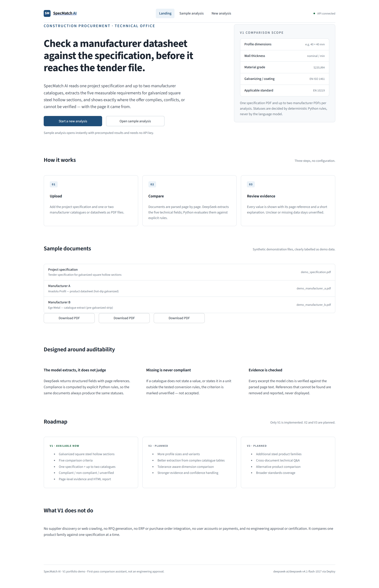
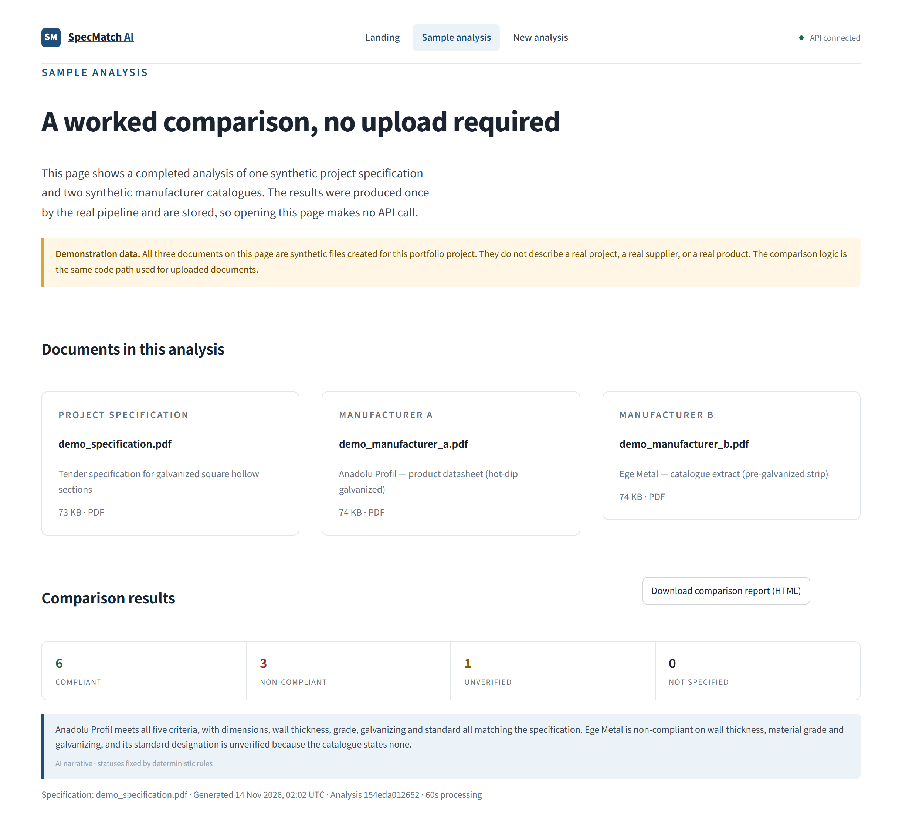
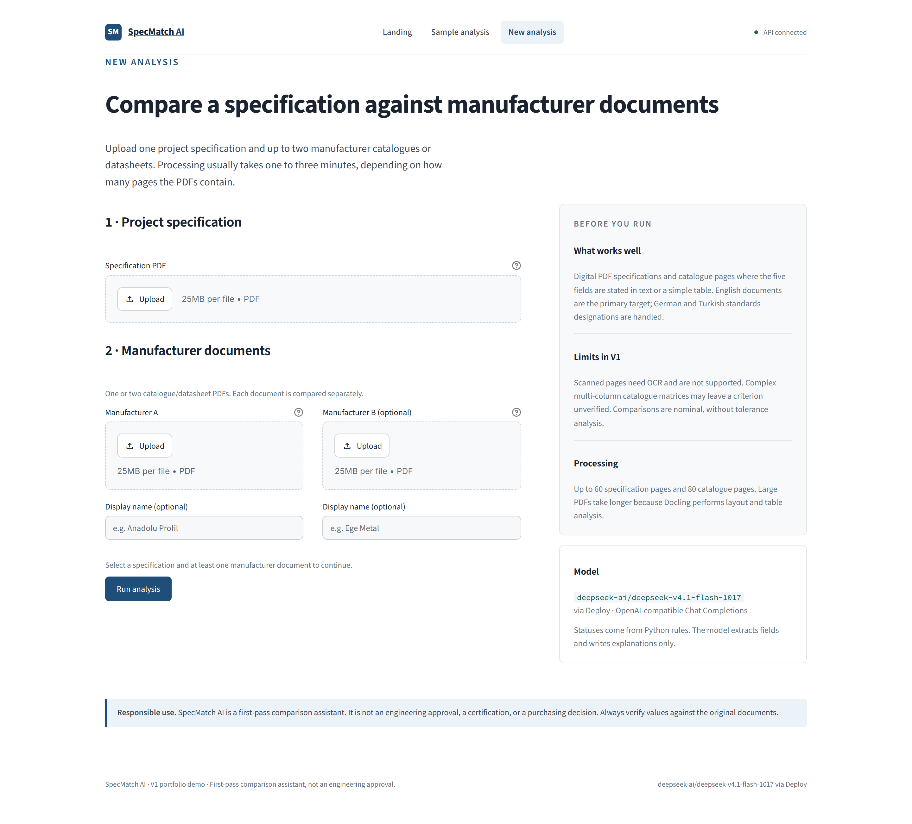
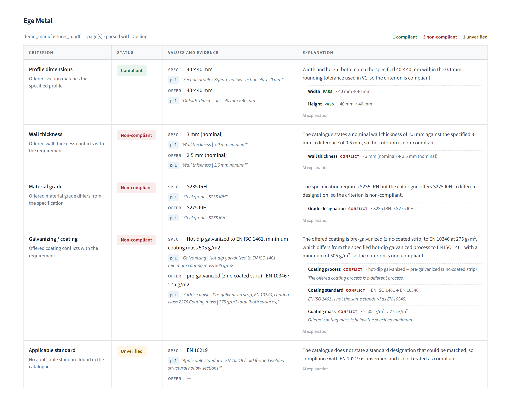
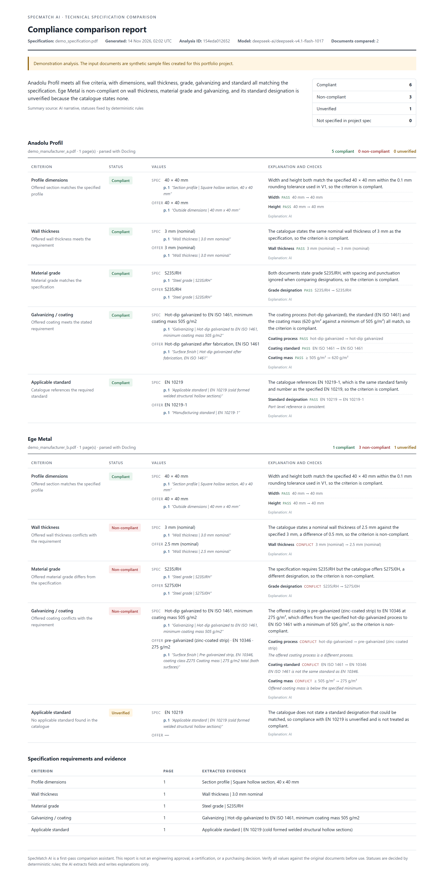

# SpecMatch AI

**English** · [Türkçe](README.tr.md)

An AI-assisted technical specification comparison tool for construction procurement.
Upload one project specification and up to two manufacturer catalogues, and get a
criterion-by-criterion comparison with page-level evidence.

> SpecMatch AI is a first-pass comparison assistant. It is not an engineering approval,
> a certification, or a purchasing decision system.

---

## Table of contents

- [The problem](#the-problem)
- [Screenshots](#screenshots)
- [What it does](#what-it-does)
- [How the comparison works](#how-the-comparison-works)
- [Workflow](#workflow)
- [Architecture](#architecture)
- [Technology stack](#technology-stack)
- [Installation](#installation)
- [Deploy API configuration](#deploy-api-configuration)
- [Usage](#usage)
- [Project scripts](#project-scripts)
- [Tests](#tests)
- [Known limitations](#known-limitations)
- [Responsible use](#responsible-use)
- [Roadmap](#roadmap)
- [Deployment status](#deployment-status)

---

## The problem

Technical-office and procurement teams check manufacturer offers against a project
specification by hand. For galvanized square steel hollow sections that means opening a
tender document and a catalogue side by side and comparing section size, wall thickness,
steel grade, galvanizing, and the applicable standard — repeatedly, for every supplier.

The comparison itself is not hard, but it is slow, easy to do inconsistently, and hard to
audit later. A missed 0.5 mm wall-thickness difference or a switch from hot-dip to
pre-galvanized strip can invalidate an offer.

SpecMatch AI automates the mechanical part: it extracts the five technical fields from
each PDF, compares them against the specification with explicit rules, and shows the exact
page and excerpt behind every value so a reviewer can check it in seconds.

## Screenshots

All screenshots below are captured from the running application.

### 1. Landing page



The landing page explains the problem, the three-step workflow, the V1 comparison scope,
and links to the sample documents. The roadmap is visible but marked as planned.

### 2. Sample analysis



A precomputed analysis of one synthetic specification and two synthetic catalogues.
Opening it makes no API call: the result was produced once by the real pipeline and is
stored in `sample_docs/precomputed/`. The demonstration-data notice is always visible.

### 3. New analysis



One specification PDF and up to two manufacturer PDFs, 25 MB each. The side panel states
what the tool handles well and where V1 stops.

### 4. Comparison results



Each criterion shows the extracted specification value, the offered value, the status, the
page reference, a short verbatim excerpt, the deterministic sub-checks, and an explanation.
This example is the non-compliant manufacturer: dimensions match, but wall thickness,
grade, galvanizing, and the standard do not.

### 5. Exported report



The downloadable report is a single self-contained HTML file with inline CSS, no scripts,
and a print-friendly layout. It repeats the summary, both comparisons, and the extracted
specification requirements.

## What it does

**Inputs**
- One project specification PDF.
- One or two manufacturer catalogue or datasheet PDFs.

**Five comparison criteria**
1. Profile dimensions (e.g. 40 × 40 mm)
2. Wall thickness (nominal, minimum, or maximum)
3. Material grade, when specified
4. Galvanizing / coating process, standard, and coating mass
5. Applicable standard, when specified

**Outputs**
- Extracted project requirements with source page and excerpt.
- A manufacturer-by-manufacturer comparison table.
- A status per criterion, decided by Python rules.
- Verbatim evidence and page references for every extracted value.
- A short explanation per criterion (AI-written, with a deterministic fallback).
- A downloadable HTML report.
- Extraction and validation notes whenever something could not be verified.

**Interface**
- A landing page, a precomputed sample analysis, and a new-analysis page.
- Empty, loading, success, and error states.
- Desktop-first layout that stays usable on narrow screens.

## How the comparison works

The single design rule is: **the model extracts, Python judges.**

DeepSeek reads the documents and returns structured fields — value, unit, page, and a
verbatim excerpt. It never returns a compliance status, and its output is validated against
a Pydantic schema that has no status field. `src/compliance.py` then applies fixed rules and
is the only place a status is assigned.

### Statuses

| Status | Meaning |
|---|---|
| **Compliant** | The available evidence meets the stated requirement and every required sub-check passed. |
| **Non-compliant** | The available evidence clearly conflicts with the requirement. |
| **Unverified** | Information is missing, ambiguous, or cannot be compared with a tested conversion rule. Never treated as compliant. |
| **Not specified** | The project specification does not state this criterion. Not a compliance verdict; excluded from compliance counts. |

The brief defines three statuses. A neutral fourth outcome is needed because the
specification may legitimately say nothing about, for example, material grade. Reporting
that case as "unverified" would blame the manufacturer for a missing project requirement,
and "compliant" would invent a requirement. `not_specified` keeps the counts honest; the
UI and the report show it separately from the three compliance statuses.

### Comparison rules (V1)

| Criterion | Rule |
|---|---|
| **Dimensions** | Width and height must both be present on both sides. Equal within 0.1 mm → compliant. A clear difference → non-compliant. |
| **Wall thickness** | Nominal → equal within 0.1 mm. Minimum → offered must be ≥ the minimum. Maximum → offered must be ≤ the maximum. |
| **Material grade** | Normalized equality (case, spaces, and hyphens ignored). A different grade → non-compliant. "Or equivalent" wording in the specification → unverified. |
| **Galvanizing** | Process (hot-dip vs pre-galvanized/bare), galvanizing standard, and minimum coating mass/thickness are checked separately. A conflict → non-compliant. A different galvanizing standard or missing evidence → unverified. All specified sub-checks pass → compliant. |
| **Standard** | Normalized designation containment, so `EN 10219` matches `EN 10219-1`. A clearly different product standard → non-compliant. |

### Units and evidence

- The model returns values **as printed** plus the unit. Python converts only with tested
  rules: mm, cm, m, in for length; g/m² for coating mass; µm and mm for coating thickness.
  Anything else becomes unverified.
- V1 compares nominally with a 0.1 mm rounding guard only. Tolerance-aware comparison is
  planned for V2.
- Every value carries a page number and a verbatim excerpt. Excerpts are checked against
  the parsed page text. Anything that cannot be found is dropped and reported as a
  validation issue rather than shown as evidence.
- Missing manufacturer data is never inferred from the specification or from the other
  manufacturer.

## Workflow

```
Upload PDFs
   ↓
Docling parses text and tables per page (pypdf fallback)
   ↓
DeepSeek extracts the five fields per document → JSON
   ↓
Pydantic validates the JSON (no status field exists in the schema)
   ↓
Evidence excerpts are verified against the parsed page text
   ↓
Python rules compare the five criteria and assign statuses
   ↓
DeepSeek writes short explanations (statuses supplied read-only)
   ↓
Streamlit renders results + evidence; the report is exported as HTML
```

If the explanation call fails, the results still render with deterministic explanation
text and a note in the validation panel. If extraction fails, the run stops with an
actionable message instead of a traceback.

## Architecture

```text
specmatch-ai/
├── app.py                     # nav shell + landing page
├── config.py                  # settings, limits, labels; reads .env
├── requirements.txt
├── .env.example               # placeholder only
├── PLAN.md                    # phases, product decisions, comparison rules
├── src/
│   ├── document_parser.py     # Docling primary, pypdf fallback, per-page text
│   ├── extraction.py          # Deploy/DeepSeek client, prompts, JSON repair
│   ├── schemas.py             # Pydantic extraction and result models
│   ├── units.py               # unit parsing and conversion
│   ├── compliance.py          # deterministic rules — the only status source
│   ├── evidence.py            # excerpt verification against page text
│   ├── pipeline.py            # orchestration and error handling
│   ├── report.py              # self-contained HTML export
│   ├── demo.py                # precomputed demo loader
│   └── ui/
│       ├── theme.py           # CSS, nav, badges, stat strip, markup helper
│       └── results.py         # comparison table, evidence, download button
├── pages/
│   ├── sample_demo.py         # precomputed demo, no API call
│   └── new_analysis.py        # upload, run, states, results
├── tests/                     # 103 tests
├── scripts/
│   ├── build_demo_pdfs.py     # regenerates the three synthetic PDFs
│   ├── build_demo_analysis.py # regenerates the precomputed demo via the real pipeline
│   └── capture_screenshots.py # regenerates docs/screenshots from the running app
├── sample_docs/
│   ├── demo_specification.pdf
│   ├── demo_manufacturer_a.pdf
│   ├── demo_manufacturer_b.pdf
│   └── precomputed/
│       ├── demo_analysis.json
│       └── demo_report.html
└── docs/screenshots/
```

**Separation of concerns**

- `compliance.py` has no network access and no AI dependency, so the engine can be tested
  on its own.
- `extraction.py` owns every API call. It exposes `extract_structured` and
  `explain_findings`, both of which the pipeline can stub out in tests.
- `pipeline.py` turns API and parsing failures into `AnalysisError` messages the UI can
  show.
- `ui/` contains presentation only; it never computes a status.

## Technology stack

| Layer | Choice |
|---|---|
| Language | Python 3.12 |
| Interface | Streamlit 1.67 (multipage) |
| PDF parsing | Docling 2.150 with a pypdf 7.1 fallback |
| AI extraction and explanations | Deploy API, `deepseek-ai/deepseek-v4.1-flash-1017` (OpenAI-compatible Chat Completions) |
| Validation | Pydantic 2 |
| Report export | Self-contained HTML with inline CSS |
| Tests | pytest |
| Demo PDFs | ReportLab |

No database, no authentication, no Docker, no backend API, and no frontend framework. The
whole application is one Streamlit process.

## Installation

**Requirements:** Python 3.12 (developed and tested on 3.12.16), a Deploy API key, and
roughly 2 GB of free disk space for Docling's models.

```bash
git clone <your-repository-url>
cd specmatch-ai
```

**Windows (PowerShell)**

```powershell
python -m venv .venv
.\.venv\Scripts\Activate.ps1
pip install -r requirements.txt
```

**macOS / Linux**

```bash
python3 -m venv .venv
source .venv/bin/activate
pip install -r requirements.txt
```

The first analysis downloads Docling's layout and table models (about 80 seconds on a
normal connection). Later runs reuse the cached models and take roughly 7–20 seconds per
PDF depending on page count and table complexity.

## Deploy API configuration

Create `.env` in the project root. Copy the example and add your key:

```bash
cp .env.example .env
```

```dotenv
DEPLOY_API_KEY=your-deploy-api-key-here
```

That is the only required setting. Optional overrides are documented in `.env.example`:

| Variable | Default |
|---|---|
| `DEPLOY_BASE_URL` | `https://api-cdn.deploy.com/api/v1` |
| `DEPLOY_MODEL` | `deepseek-ai/deepseek-v4.1-flash-1017` |
| `DEPLOY_TIMEOUT_SECONDS` | `180` |
| `DEPLOY_MAX_COMPLETION_TOKENS` | `4000` |
| `DEPLOY_REASONING_EFFORT` | `high` |

Notes:

- `.env` is listed in `.gitignore` and must never be committed.
- `.env.example` contains a placeholder only.
- Nothing in the application logs or displays the key. The UI only shows whether a key is
  configured.
- The sample analysis needs no key at all, because it is precomputed.

## Usage

Start the app:

```bash
streamlit run app.py
```

Streamlit prints a local URL, normally `http://localhost:8501`.

**Explore the sample analysis**

Open **Sample analysis** in the top navigation. It shows the stored result for the three
synthetic demo PDFs, including the non-compliant case with its evidence. No API call is
made. The three demo PDFs themselves are downloadable from the landing page.

**Run a real comparison**

1. Open **New analysis**.
2. Upload one specification PDF.
3. Upload one or two manufacturer PDFs and optionally give each a display name.
4. Select **Run analysis** and wait. Parsing plus two model calls per document typically
   takes one to three minutes.
5. Review the extracted requirements, the comparison tables, and the validation notes.
6. Download the HTML report.

Limits: 25 MB per file, 60 pages per specification, 80 pages per catalogue.

## Project scripts

| Script | Purpose |
|---|---|
| `python scripts/build_demo_pdfs.py` | Rebuild the three synthetic demo PDFs. Every page carries a visible "SYNTHETIC DEMO DOCUMENT" banner. |
| `python scripts/build_demo_analysis.py` | Run the real pipeline on the demo PDFs and rewrite `sample_docs/precomputed/`. Makes API calls. |
| `python scripts/capture_screenshots.py` | Capture the five README screenshots from the running app on port 8531 using Playwright. |
| `python scripts/e2e_check.py` | End-to-end check: upload all three PDFs, run a real analysis, verify results, download the report. Makes API calls. |
| `python scripts/check_docs.py` | Verify README links, screenshot paths, in-page anchors, and that no API key or local absolute path appears in the docs. |
| `python scripts/release_audit.py` | Audit the working tree before publishing: secret patterns, the real key, `.env.example` placeholders, and `.gitignore` coverage. |
| `python scripts/staged_audit.py` | The authoritative pre-commit check: reads each staged Git blob and fails if the real key, a credential pattern, or a forbidden path is staged. |

The screenshot script expects the app on `http://127.0.0.1:8531`, so start it with:

```bash
streamlit run app.py --server.port 8531 --server.headless true
```

## Tests

```bash
pytest tests -q
```

103 tests, currently all passing. They cover:

- unit normalization and conversion, including unsupported units
- every comparison rule and its edge cases (exact match, clear mismatch, missing data,
  optional criteria absent from the specification)
- evidence verification and rejection of fabricated pages or excerpts
- model-output validation, including rejection of a payload that smuggles in a status
- pipeline behaviour with the AI layer stubbed: no network, API failure, explanation
  failure, more than two manufacturers, missing API key
- report generation

The comparison engine is tested without any API key and without network access.

## Known limitations

- **One product family.** Galvanized square steel hollow sections only. Rectangular,
  circular, and other sections are out of scope for V1.
- **No OCR.** Scanned or image-only PDFs are rejected with a clear message. Digital PDFs
  are required.
- **Nominal comparison.** Dimensions use a 0.1 mm rounding guard only. Manufacturing
  tolerances per EN 10219 are not evaluated.
- **Complex tables.** Dense multi-column catalogue matrices may leave a criterion
  unverified. V1 never guesses a value from a neighbouring row.
- **English-first prompts.** German and Turkish standard designations are handled, but the
  documents are not translated.
- **Page-level, not sentence-level, traceability.** Evidence points to a page and a
  verbatim excerpt, not to coordinates in the PDF layout.
- **Single-run session.** Results live in the Streamlit session. There is no history, no
  saved projects, and no database.
- **Model variability.** Extraction is validated and evidence-checked, but a different
  phrasing in a catalogue can still change what is extracted. Always confirm against the
  original document.

## Responsible use

- Treat every output as a **first pass**, not as a verdict. Verify values against the
  original PDFs before using them in a tender evaluation or purchase order.
- The comparison covers five criteria. Contractual terms, delivery, testing certificates,
  mill certificates, and price are not evaluated.
- Statuses come from fixed rules, but those rules encode a simplified reading of the
  standards. A qualified engineer remains responsible for the technical decision.
- Uploaded documents may be commercially confidential. The contents are sent to the
  configured Deploy API for extraction, so check your organisation's data policy before
  using real tender documents.
- The demo documents are synthetic. They do not describe a real project, supplier, or
  product.

## Roadmap

### V1 — Implemented

- One product family: galvanized square steel hollow sections.
- PDF upload and page-aware extraction.
- Five comparison criteria.
- Up to two manufacturer documents per analysis.
- Compliant / non-compliant / unverified, plus `not_specified` for criteria the project
  specification does not state.
- Page references and verbatim evidence checked against parsed text.
- AI-written explanations with a deterministic fallback.
- Downloadable self-contained HTML report.
- Precomputed sample analysis that needs no API call.

### V2 — Planned

- More profile dimensions and variants.
- Better extraction from complex catalogue tables.
- Tolerance-aware dimension comparison.
- Stronger evidence and confidence handling.

### V3 — Planned

- Additional steel product families.
- Cross-document technical Q&A.
- Alternative product comparison.
- Broader standards and specification coverage.

Nothing in V2 or V3 is implemented. Those items are listed as planned direction only.

## Deployment status

The application has been run and tested locally only. There is no public demo URL yet, so
no live link is provided here. When a deployment exists, it will be added to this section.

Deployment is not required for the sample analysis: it is fully precomputed and works
without an API key.

---

**Documentation:** [English](README.md) · [Türkçe](README.tr.md)
