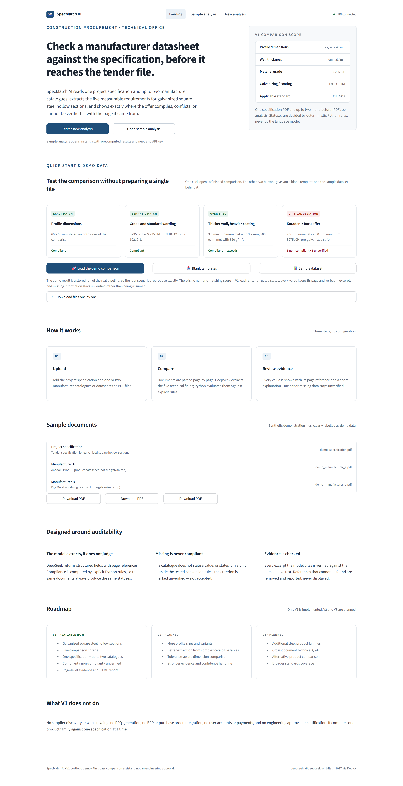
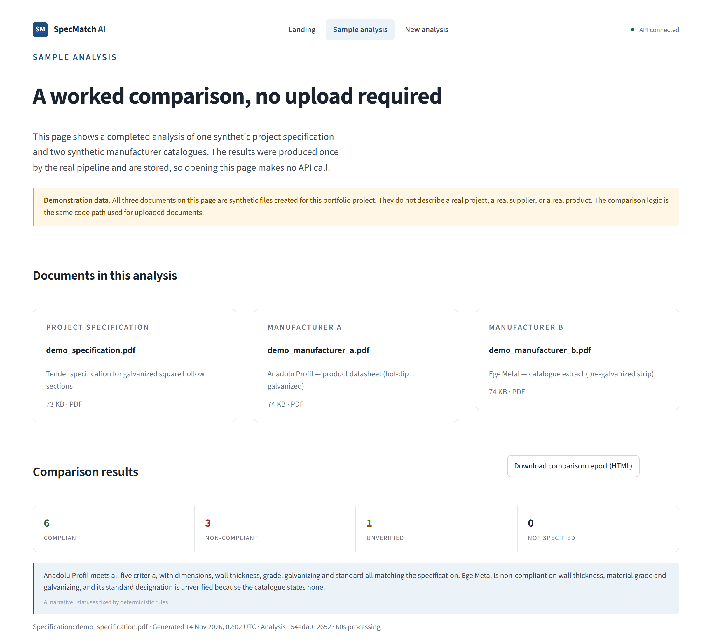
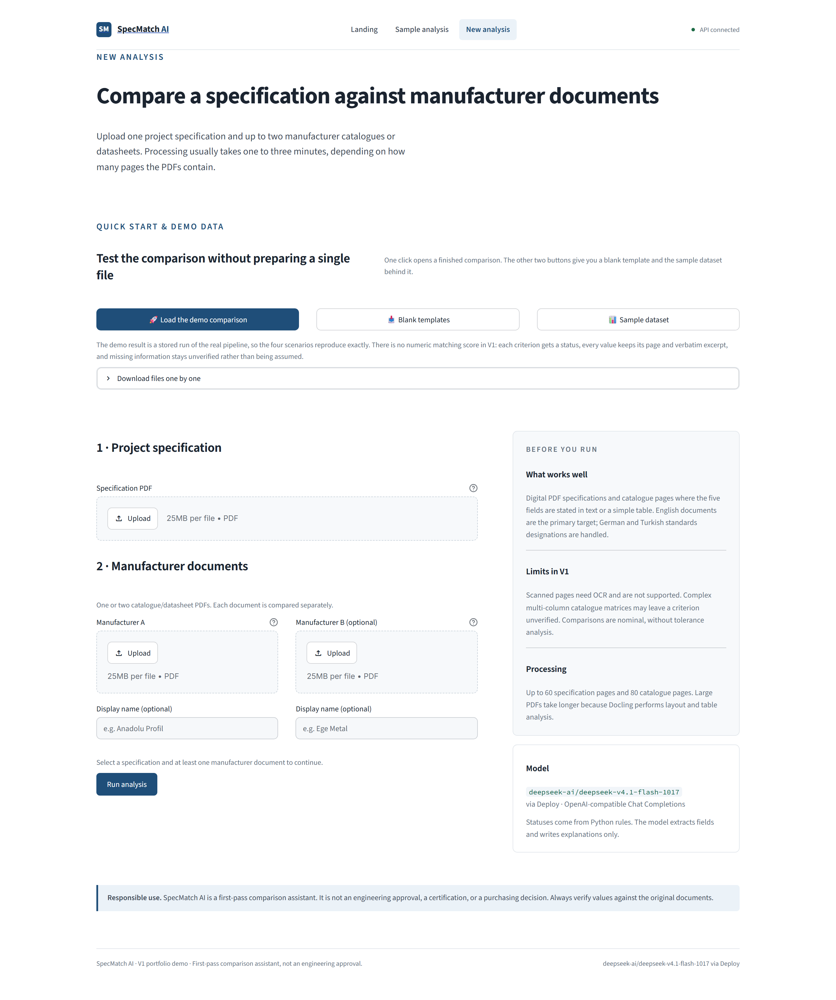
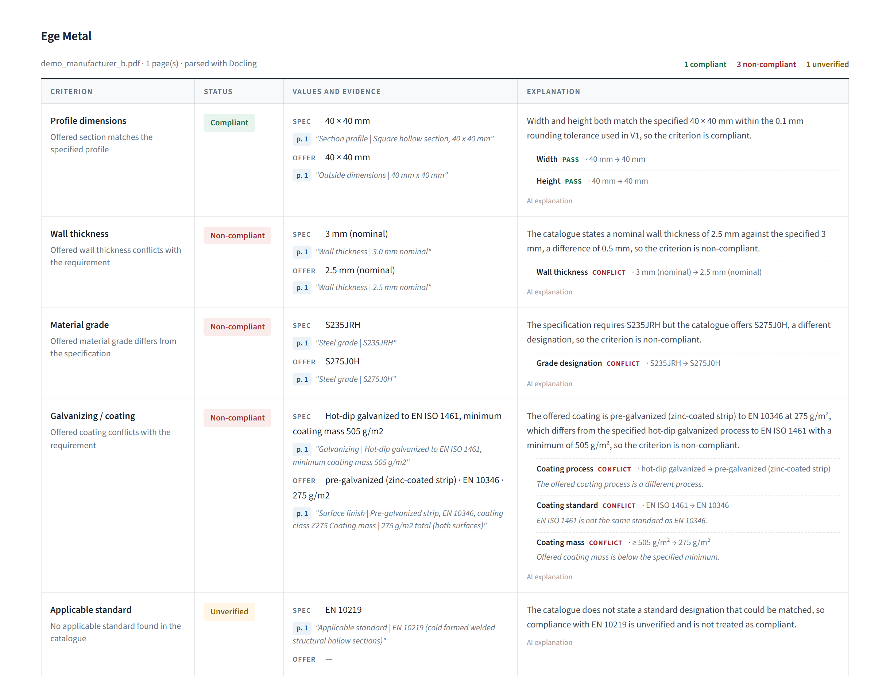
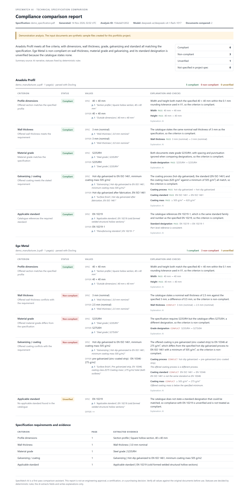

# SpecMatch AI

[English](README.md) · **Türkçe**

İnşaat satın alma süreçleri için yapay zekâ destekli teknik şartname karşılaştırma aracı.
Bir proje şartnamesi ile en fazla iki üretici kataloğunu yükleyin; kriter bazında, sayfa
düzeyinde kanıta dayalı bir karşılaştırma elde edin.

> SpecMatch AI bir ilk geçiş karşılaştırma asistanıdır. Mühendislik onayı, sertifikasyon
> veya satın alma kararı sistemi değildir.

---

## İçindekiler

- [Sorun](#sorun)
- [Ekran görüntüleri](#ekran-görüntüleri)
- [Hızlı başlangıç](#hızlı-başlangıç)
- [Ne yapar](#ne-yapar)
- [Karşılaştırma nasıl çalışır](#karşılaştırma-nasıl-çalışır)
- [İş akışı](#iş-akışı)
- [Mimari](#mimari)
- [Teknoloji yığını](#teknoloji-yığını)
- [Kurulum](#kurulum)
- [Deploy API yapılandırması](#deploy-api-yapılandırması)
- [Kullanım](#kullanım)
- [Proje betikleri](#proje-betikleri)
- [Testler](#testler)
- [Bilinen sınırlamalar](#bilinen-sınırlamalar)
- [Sorumlu kullanım](#sorumlu-kullanım)
- [Yol haritası](#yol-haritası)
- [Dağıtım durumu](#dağıtım-durumu)

---

## Sorun

Teknik ofis ve satın alma ekipleri, üretici tekliflerini proje şartnamesine göre elle
kontrol eder. Galvanizli kare çelik içi boş profiller için bu, bir ihale dokümanı ile bir
kataloğu yan yana açıp kesit ölçüsü, et kalınlığı, çelik kalitesi, galvanizleme ve geçerli
standardı karşılaştırmak anlamına gelir — her tedarikçi için tekrar tekrar.

Karşılaştırmanın kendisi zor değildir; ama yavaştır, tutarsız yapılmaya açıktır ve sonradan
denetlenmesi güçtür. Gözden kaçan 0,5 mm'lik bir et kalınlığı farkı ya da sıcak daldırma
galvanizden ön galvanizli şeride geçiş, bir teklifi geçersiz kılabilir.

SpecMatch AI işin mekanik kısmını otomatikleştirir: her PDF'ten beş teknik alanı çıkarır,
bunları şartnameye karşı açık kurallarla karşılaştırır ve her değerin arkasındaki sayfayı ve
alıntıyı gösterir; böylece bir gözden geçiren kişi saniyeler içinde doğrulayabilir.

## Ekran görüntüleri

Aşağıdaki tüm ekran görüntüleri çalışan uygulamadan alınmıştır.

### 1. Açılış sayfası



Açılış sayfası sorunu, üç adımlı iş akışını ve V1 karşılaştırma kapsamını anlatır; hızlı
başlangıç paneliyle açılır: tek tıkla demo karşılaştırma, boş şablonlar ve örnek veri seti.
Yol haritası görünür ama planlanan olarak işaretlenmiştir.

### 2. Örnek analiz



Bir sentetik şartname ve iki sentetik katalog üzerinde önceden hesaplanmış analiz. Sayfayı
açmak hiçbir API çağrısı yapmaz: sonuç gerçek iş akışıyla bir kez üretilip
`sample_docs/precomputed/` altında saklanır. Demonstrasyon verisi uyarısı her zaman
görünür.

### 3. Yeni analiz



Bir şartname PDF'i ve en fazla iki üretici PDF'i, her biri 25 MB. Yan panel aracın nerede
iyi çalıştığını ve V1'in nerede durduğunu açıklar.

### 4. Karşılaştırma sonuçları



Her kriter şartnamedeki değeri, teklif edilen değeri, durumu, sayfa referansını, kısa bir
birebir alıntıyı, deterministik alt kontrolleri ve açıklamayı gösterir. Bu örnek uygun
olmayan üreticidir: ölçüler eşleşiyor, ancak et kalınlığı, kalite, galvanizleme ve standart
eşleşmiyor.

### 5. Dışa aktarılan rapor



İndirilebilir rapor; satır içi CSS kullanan, betik içermeyen, yazdırmaya uygun tek bir
HTML dosyasıdır. Özeti, iki karşılaştırmayı ve şartnameden çıkarılan gereksinimleri
yansıtır.

## Hızlı başlangıç

Açılış sayfasında, yükleme alanının hemen üstünde **Quick start & demo data** paneli
bulunur. API anahtarı ve kendi dosyalarınız gerekmez.

| Düğme | Ne yapar |
|---|---|
| **🚀 Load the demo comparison** | Bir şartname ile iki üretici teklifinin tamamlanmış karşılaştırmasını açar. Sonuç önceden hesaplanmıştır; yükleme, API çağrısı ve bekleme yoktur. |
| **📥 Blank templates** | Boş şartname PDF'i, boş üretici PDF'i ve alan kılavuzunu içeren bir ZIP indirir. |
| **📊 Sample dataset** | **New analysis** sayfasında yüklenmeye hazır üç örnek PDF'i içeren bir ZIP indirir. |

**"Şablon" kelimesi hakkında bir not.** SpecMatch AI CSV veya Excel okumaz. PDF okur ve
beş teknik alanı bir dil modeliyle çıkarır; bu nedenle sütun şablonu girdiyi tanımlamaz.
Boş şablonlar, çıkarıcının aradığı beş etiketi taşıyan boş PDF veri sayfalarıdır.
`field_guide.csv` bu alanların belgeleridir — etiketler, kabul edilen birimler ve her
durumun arkasındaki kural — girdi dosyası değildir.

**Dört gösterim senaryosu** dört ayrı dosyada değil, iki üretici dokümanında yer alır:

| Senaryo | Nerede görünür |
|---|---|
| Tam uyum | Ölçüler: her iki tarafta `60 × 60 mm`. |
| Anlamsal uyum | `S235JRH` ile `S 235 JRH`, `EN 10219` ile `EN 10219-1`. |
| Üst özellik | `3.0 mm minimum` gereksinimine karşı `3.2 mm minimum`; `505 g/m²` kaplamaya karşı `620 g/m²`. |
| Kritik sapma | Karadeniz Boru: `3.0 mm minimum` yerine `2.5 mm nominal`, `S275J0H` kalitesi ve sıcak daldırma `EN ISO 1461` yerine ön galvanizli şerit `EN 10346 Z275`. |

Demo, iki teklif için **6 uyumlu, 3 uyumsuz, 1 doğrulanamaz** sonuçla açılır. V1'de sayısal
eşleştirme skoru yoktur — her kriter bir durum alır ve eksik bilgi varsayılmak yerine
doğrulanamaz olarak kalır.

## Ne yapar

**Girdiler**
- Bir proje şartnamesi PDF'i.
- Bir veya iki üretici kataloğu / veri sayfası PDF'i.

**Beş karşılaştırma kriteri**
1. Profil ölçüleri (ör. 40 × 40 mm)
2. Et kalınlığı (nominal, minimum veya maksimum)
3. Malzeme kalitesi (belirtilmişse)
4. Galvanizleme / kaplama süreci, standardı ve kaplama miktarı
5. Geçerli standart (belirtilmişse)

**Çıktılar**
- Kaynak sayfa ve alıntıyla birlikte çıkarılan proje gereksinimleri.
- Üretici bazında karşılaştırma tablosu.
- Her kriter için Python kurallarıyla belirlenen durum.
- Her değer için birebir kanıt ve sayfa referansı.
- Kriter başına kısa açıklama (yapay zekâ yazımı, deterministik yedek metinle).
- İndirilebilir HTML raporu.
- Doğrulanamayan her durum için çıkarma ve doğrulama notları.

**Arayüz**
- Açılış sayfası, önceden hesaplanmış örnek analiz ve yeni analiz sayfası.
- Boş, yükleniyor, başarı ve hata durumları.
- Masaüstü öncelikli, dar ekranlarda da kullanılabilir düzen.

## Karşılaştırma nasıl çalışır

Tek tasarım kuralı: **model çıkarır, Python karar verir.**

DeepSeek dokümanları okur ve yapılandırılmış alanlar döndürür — değer, birim, sayfa ve
birebir alıntı. Hiçbir zaman uygunluk durumu döndürmez; çıktısı, durum alanı bulunmayan bir
Pydantic şemasına göre doğrulanır. Ardından `src/compliance.py` sabit kuralları uygular ve
durumun atandığı tek yer burasıdır.

### Durumlar

| Durum | Anlamı |
|---|---|
| **Uygun (Compliant)** | Mevcut kanıt belirtilen gereksinimi karşılıyor ve gerekli tüm alt kontroller geçti. |
| **Uygun değil (Non-compliant)** | Mevcut kanıt gereksinimle açıkça çelişiyor. |
| **Doğrulanamadı (Unverified)** | Bilgi eksik, belirsiz veya test edilmiş bir dönüşüm kuralıyla karşılaştırılamıyor. Asla uygun sayılmaz. |
| **Belirtilmemiş (Not specified)** | Proje şartnamesi bu kriteri hiç belirtmiyor. Uygunluk hükmü değildir; uygunluk sayımlarına dahil edilmez. |

Şartname üç durum tanımlar. Dördüncü ve nötr bir sonuç gereklidir, çünkü şartname örneğin
malzeme kalitesi hakkında hiçbir şey söylemeyebilir. Bu durumu "doğrulanamadı" diye
raporlamak, eksik bir proje gereksinimini üreticinin hanesine yazmak olur; "uygun" demek ise
var olmayan bir gereksinim uydurmak olur. `Belirtilmemiş` sayımları dürüst tutar; arayüz ve
rapor bunu üç uygunluk durumundan ayrı gösterir.

### Karşılaştırma kuralları (V1)

| Kriter | Kural |
|---|---|
| **Ölçüler** | Genişlik ve yükseklik her iki tarafta da bulunmalıdır. 0,1 mm içinde eşit → uygun. Açık bir fark → uygun değil. |
| **Et kalınlığı** | Nominal → 0,1 mm içinde eşit. Minimum → teklif edilen ≥ minimum olmalı. Maksimum → teklif edilen ≤ maksimum olmalı. |
| **Malzeme kalitesi** | Normalleştirilmiş eşitlik (büyük/küçük harf, boşluk ve tire farkı gözetilmez). Farklı kalite → uygun değil. Şartnamede "veya eşdeğeri" ifadesi → doğrulanamadı. |
| **Galvanizleme** | Süreç (sıcak daldırma ile ön galvanizli/kaplamasız), galvaniz standardı ve minimum kaplama miktarı/kalınlığı ayrı ayrı kontrol edilir. Çelişki → uygun değil. Farklı galvaniz standardı veya eksik kanıt → doğrulanamadı. Belirtilen tüm alt kontroller geçerse → uygun. |
| **Standart** | Normalleştirilmiş numara içerme kontrolü; böylece `EN 10219`, `EN 10219-1` ile eşleşir. Açıkça farklı bir ürün standardı → uygun değil. |

### Birimler ve kanıt

- Model değerleri **basıldığı gibi** ve birimiyle birlikte döndürür. Python yalnızca test
  edilmiş kurallarla dönüşüm yapar: uzunluk için mm, cm, m, in; kaplama miktarı için g/m²;
  kaplama kalınlığı için µm ve mm. Bunların dışındaki her şey doğrulanamadı olur.
- V1 yalnızca 0,1 mm yuvarlama korumasıyla nominal karşılaştırma yapar. Tolerans farkındalı
  karşılaştırma V2 için planlanmıştır.
- Her değer bir sayfa numarası ve birebir alıntı taşır. Alıntılar, ayrıştırılmış sayfa
  metnine karşı kontrol edilir. Bulunamayan kanıt gösterilmez, doğrulama sorunu olarak
  raporlanır.
- Eksik üretici verisi şartnameden veya diğer üreticiden çıkarsanmaz.

## İş akışı

```
PDF yükleme
   ↓
Docling sayfa bazında metin ve tablo ayrıştırır (pypdf yedeği)
   ↓
DeepSeek her doküman için beş alanı çıkarır → JSON
   ↓
Pydantic JSON'u doğrular (şemada durum alanı yoktur)
   ↓
Kanıt alıntıları ayrıştırılmış sayfa metnine karşı doğrulanır
   ↓
Python kuralları beş kriteri karşılaştırır ve durumları atar
   ↓
DeepSeek kısa açıklamalar yazar (durumlar salt okunur verilir)
   ↓
Streamlit sonuçları ve kanıtı gösterir; rapor HTML olarak dışa aktarılır
```

Açıklama çağrısı başarısız olursa sonuçlar yine deterministik açıklama metniyle ve
doğrulama panelinde bir notla görüntülenir. Çıkarma başarısız olursa çalışma, iz (traceback)
yerine eyleme dönüştürülebilir bir mesajla durur.

## Mimari

```text
specmatch-ai/
├── app.py                     # gezinme kabuğu + açılış sayfası
├── config.py                  # ayarlar, limitler, etiketler; .env okur
├── requirements.txt
├── .env.example               # yalnızca yer tutucu
├── PLAN.md                    # aşamalar, ürün kararları, karşılaştırma kuralları
├── src/
│   ├── document_parser.py     # Docling birincil, pypdf yedek, sayfa bazlı metin
│   ├── extraction.py          # Deploy/DeepSeek istemcisi, istemler, JSON onarımı
│   ├── schemas.py             # Pydantic çıkarma ve sonuç modelleri
│   ├── units.py               # birim ayrıştırma ve dönüştürme
│   ├── compliance.py          # deterministik kurallar — tek durum kaynağı
│   ├── evidence.py            # alıntıların sayfa metnine karşı doğrulanması
│   ├── pipeline.py            # orkestrasyon ve hata yönetimi
│   ├── report.py              # kendi kendine yeterli HTML dışa aktarımı
│   ├── demo.py                # önceden hesaplanmış demo yükleyici
│   ├── quickstart.py          # hızlı başlangıç yükleyici, şablon ve veri seti arşivleri
│   └── ui/
│       ├── theme.py           # CSS, gezinme, rozetler, istatistik şeridi, markup yardımcısı
│       ├── quickstart_panel.py # açılış sayfası hızlı başlangıç paneli ve satır içi demo
│       └── results.py         # karşılaştırma tablosu, kanıt, indirme düğmesi
├── pages/
│   ├── sample_demo.py         # önceden hesaplanmış demo, API çağrısı yok
│   └── new_analysis.py        # yükleme, çalıştırma, durumlar, sonuçlar
├── tests/                     # 112 test
├── scripts/
│   ├── build_demo_pdfs.py     # üç sentetik PDF'i yeniden üretir
│   ├── build_demo_analysis.py # önceden hesaplanmış demoyu gerçek iş akışıyla yeniler
│   ├── build_quickstart_docs.py     # Quick Start senaryo PDF'lerini yeniden üretir
│   ├── build_quickstart_analysis.py # önceden hesaplanmış Quick Start sonucunu yeniler
│   ├── build_templates.py     # boş şablonları ve alan kılavuzunu yeniler
│   └── capture_screenshots.py # docs/screenshots'ı çalışan uygulamadan yeniler
├── sample_docs/
│   ├── demo_specification.pdf
│   ├── demo_manufacturer_a.pdf
│   ├── demo_manufacturer_b.pdf
│   ├── quickstart/
│   │   ├── quickstart_specification.pdf
│   │   ├── quickstart_manufacturer_a.pdf
│   │   └── quickstart_manufacturer_b.pdf
│   ├── templates/
│   │   ├── template_specification.pdf
│   │   ├── template_manufacturer.pdf
│   │   └── field_guide.csv
│   └── precomputed/
│       ├── demo_analysis.json
│       ├── demo_report.html
│       └── quickstart_analysis.json
└── docs/screenshots/
```

**Sorumluluk ayrımı**

- `compliance.py` ağ erişimi ve yapay zekâ bağımlılığı içermez; motor tek başına test
  edilebilir.
- Tüm API çağrıları `extraction.py` içindedir. `extract_structured` ve `explain_findings`
  fonksiyonlarını testlerde taklit (stub) ile değiştirmek mümkündür.
- `pipeline.py` API ve ayrıştırma hatalarını arayüzün gösterebileceği `AnalysisError`
  mesajlarına dönüştürür.
- `ui/` yalnızca sunum içerir; hiçbir durum hesaplamaz.

## Teknoloji yığını

| Katman | Seçim |
|---|---|
| Dil | Python 3.12 |
| Arayüz | Streamlit 1.67 (çok sayfalı) |
| PDF ayrıştırma | Docling 2.150, pypdf 7.1 yedeğiyle |
| Yapay zekâ çıkarma ve açıklama | Deploy API, `deepseek-ai/deepseek-v4.1-flash-1017` (OpenAI uyumlu Chat Completions) |
| Doğrulama | Pydantic 2 |
| Rapor dışa aktarımı | Satır içi CSS ile kendi kendine yeterli HTML |
| Testler | pytest |
| Demo PDF'leri | ReportLab |

Veritabanı, kimlik doğrulama, Docker, arka uç API'si ve ön uç çatısı yoktur. Tüm uygulama
tek bir Streamlit sürecidir.

## Kurulum

**Gereksinimler:** Python 3.12 (3.12.16 üzerinde geliştirildi ve test edildi), bir Deploy API
anahtarı ve Docling modelleri için yaklaşık 2 GB boş disk alanı.

```bash
git clone <depo-adresiniz>
cd specmatch-ai
```

**Windows (PowerShell)**

```powershell
python -m venv .venv
.\.venv\Scripts\Activate.ps1
pip install -r requirements.txt
```

**macOS / Linux**

```bash
python3 -m venv .venv
source .venv/bin/activate
pip install -r requirements.txt
```

İlk analizde Docling'in yerleşim ve tablo modelleri indirilir (normal bağlantıda yaklaşık 80
saniye). Sonraki çalışmalar önbellekteki modelleri kullanır ve sayfa sayısı ile tablo
karmaşıklığına bağlı olarak PDF başına yaklaşık 7–20 saniye sürer.

## Deploy API yapılandırması

Proje kökünde `.env` oluşturun. Örneği kopyalayıp anahtarınızı ekleyin:

```bash
cp .env.example .env
```

```dotenv
DEPLOY_API_KEY=your-deploy-api-key-here
```

Gerekli tek ayar budur. İsteğe bağlı geçersiz kılmalar `.env.example` içinde belgelidir:

| Değişken | Varsayılan |
|---|---|
| `DEPLOY_BASE_URL` | `https://api-cdn.deploy.com/api/v1` |
| `DEPLOY_MODEL` | `deepseek-ai/deepseek-v4.1-flash-1017` |
| `DEPLOY_TIMEOUT_SECONDS` | `180` |
| `DEPLOY_MAX_COMPLETION_TOKENS` | `4000` |
| `DEPLOY_REASONING_EFFORT` | `high` |

Notlar:

- `.env` `.gitignore` içindedir ve asla commit edilmemelidir.
- `.env.example` yalnızca yer tutucu içerir.
- Uygulama anahtarı hiçbir yere yazmaz veya göstermez. Arayüz yalnızca anahtarın tanımlı
  olup olmadığını belirtir.
- Örnek analiz önceden hesaplandığı için hiçbir anahtar gerektirmez.

## Kullanım

Uygulamayı başlatın:

```bash
streamlit run app.py
```

Streamlit yerel bir adres yazar, genellikle `http://localhost:8501`.

**Örnek analizi inceleyin**

Üst gezinmeden **Sample analysis** sayfasını açın. Üç sentetik demo PDF için saklanan sonucu,
uygun olmayan örneği ve kanıtlarını gösterir. Hiçbir API çağrısı yapılmaz. Üç demo PDF'in
kendisi açılış sayfasından indirilebilir.

**Veya hızlı başlangıç demosunu açın**

Açılış sayfasındaki Quick start panelinde **🚀 Load the demo comparison** düğmesine basın.
Dört senaryolu karşılaştırma sayfanın içinde açılır; **Close demo results** düğmesi tekrar
gizler. **New analysis** sayfasında aynı düğme sonucu sayfanın normal sonuç görünümüne
yükler; **Start another analysis** temizler ve yükleme formunu geri getirir.

**Gerçek bir karşılaştırma çalıştırın**

1. **New analysis** sayfasını açın.
2. Bir şartname PDF'i yükleyin.
3. Bir veya iki üretici PDF'i yükleyin, isterseniz her birine görünen ad verin.
4. **Run analysis** düğmesine basın ve bekleyin. Ayrıştırma ve doküman başına iki model
   çağrısı genellikle bir ile üç dakika sürer.
5. Çıkarılan gereksinimleri, karşılaştırma tablolarını ve doğrulama notlarını inceleyin.
6. HTML raporunu indirin.

Limitler: dosya başına 25 MB, şartname için 60 sayfa, katalog için 80 sayfa.

## Proje betikleri

| Betik | Amaç |
|---|---|
| `python scripts/build_demo_pdfs.py` | Üç sentetik demo PDF'i yeniden üretir. Her sayfada görünür "SYNTHETIC DEMO DOCUMENT" şeridi bulunur. |
| `python scripts/build_demo_analysis.py` | Demo PDF'ler üzerinde gerçek iş akışını çalıştırır ve `sample_docs/precomputed/` içeriğini yeniler. API çağrısı yapar. |
| `python scripts/build_quickstart_docs.py` | Üç Quick Start senaryo PDF'ini (bir şartname, iki üretici teklifi) yeniden üretir. |
| `python scripts/build_quickstart_analysis.py` | Quick Start PDF'leri üzerinde gerçek iş akışını çalıştırır ve `sample_docs/precomputed/quickstart_analysis.json` dosyasını yeniler. API çağrısı yapar. |
| `python scripts/build_templates.py` | Boş PDF şablonlarını ve `field_guide.csv` dosyasını yeniden üretir. |
| `python scripts/capture_screenshots.py` | 8531 portunda çalışan uygulamadan Playwright ile beş README ekran görüntüsünü alır. |
| `python scripts/e2e_check.py` | Uçtan uca kontrol: üç PDF'i yükler, gerçek analiz çalıştırır, sonuçları doğrular, raporu indirir. API çağrısı yapar. |
| `python scripts/check_docs.py` | README bağlantılarını, ekran görüntüsü yollarını, sayfa içi bağlantıları ve dokümanlarda API anahtarı veya yerel mutlak yol bulunmadığını doğrular. |
| `python scripts/release_audit.py` | Yayın öncesi çalışma ağacını denetler: gizli bilgi kalıpları, gerçek anahtar, `.env.example` yer tutucuları ve `.gitignore` kapsamı. |
| `python scripts/staged_audit.py` | Asıl commit öncesi kontrol: her staged Git blob'unu okur ve gerçek anahtar, kimlik bilgisi kalıbı veya yasaklı yol stage edilmişse başarısız olur. |

Ekran görüntüsü betiği uygulamanın `http://127.0.0.1:8531` adresinde çalışmasını bekler:

```bash
streamlit run app.py --server.port 8531 --server.headless true
```

## Testler

```bash
pytest tests -q
```

112 test, tamamı geçiyor. Kapsam:

- birim normalleştirme ve dönüştürme, desteklenmeyen birimler dahil
- her karşılaştırma kuralı ve uç durumları (tam eşleşme, açık uyuşmazlık, eksik veri,
  şartnamede belirtilmeyen isteğe bağlı kriterler)
- kanıt doğrulama ve uydurulmuş sayfa veya alıntıların reddedilmesi
- model çıktısı doğrulama; durum bilgisi kaçırmaya çalışan bir yükün reddi dahil
- yapay zekâ katmanı taklit edilerek iş akışı davranışı: ağ yok, API hatası, açıklama
  hatası, ikiden fazla üretici, eksik API anahtarı
- rapor üretimi
- hızlı başlangıç veri katmanı: duyurulan dört senaryonun önceden hesaplanmış sonuçla
  eşleşmesi ve iki ZIP arşivinin beklenen dosyaları içermesi

Karşılaştırma motoru hiçbir API anahtarı ve ağ erişimi olmadan test edilir.

## Bilinen sınırlamalar

- **Tek ürün ailesi.** Yalnızca galvanizli kare çelik içi boş profiller. Dikdörtgen,
  dairesel ve diğer kesitler V1 kapsamı dışındadır.
- **OCR yok.** Taranmış veya yalnızca görüntü içeren PDF'ler açık bir mesajla reddedilir.
  Dijital PDF'ler gereklidir.
- **Nominal karşılaştırma.** Ölçülerde yalnızca 0,1 mm yuvarlama koruması vardır. EN
  10219'daki üretim toleransları değerlendirilmez.
- **Karmaşık tablolar.** Yoğun çok sütunlu katalog matrisleri bir kriteri doğrulanamadı
  bırakabilir. V1 komşu satırdan değer tahmin etmez.
- **İngilizce öncelikli istemler.** Almanca ve Türkçe standart gösterimleri işlenir, ancak
  dokümanlar çevrilmez.
- **Sayfa düzeyinde, cümle düzeyinde olmayan izlenebilirlik.** Kanıt bir sayfayı ve birebir
  alıntıyı gösterir; PDF yerleşimindeki koordinatları göstermez.
- **Tek çalıştırmalık oturum.** Sonuçlar Streamlit oturumunda yaşar. Geçmiş, kayıtlı proje
  ve veritabanı yoktur.
- **Model değişkenliği.** Çıkarma doğrulanır ve kanıt kontrolünden geçer, ancak bir
  katalogdaki farklı bir ifade çıkarılanı değiştirebilir. Her zaman orijinal dokümandan
  doğrulayın.

## Sorumlu kullanım

- Her çıktıyı bir **ilk geçiş** olarak değerlendirin, hüküm olarak değil. İhale
  değerlendirmesinde veya satın alma siparişinde kullanmadan önce değerleri orijinal
  PDF'lerden doğrulayın.
- Karşılaştırma beş kriteri kapsar. Sözleşme koşulları, teslimat, test sertifikaları, hadde
  sertifikaları ve fiyat değerlendirilmez.
- Durumlar sabit kurallardan gelir, ancak bu kurallar standartların basitleştirilmiş bir
  okumasını kodlar. Teknik kararın sorumluluğu yetkin bir mühendiste kalır.
- Yüklenen dokümanlar ticari olarak gizli olabilir. İçerikler çıkarma için yapılandırılmış
  Deploy API'sine gönderilir; gerçek ihale dokümanlarını kullanmadan önce kurumunuzun veri
  politikasını kontrol edin.
- Demo dokümanlar sentetiktir. Gerçek bir projeyi, tedarikçiyi veya ürünü tanımlamazlar.

## Yol haritası

### V1 — Uygulandı

- Tek ürün ailesi: galvanizli kare çelik içi boş profiller.
- PDF yükleme ve sayfa farkındalı çıkarma.
- Beş karşılaştırma kriteri.
- Analiz başına en fazla iki üretici dokümanı.
- Uygun / uygun değil / doğrulanamadı; ayrıca proje şartnamesinin belirtmediği kriterler
  için `belirtilmemiş`.
- Sayfa referansları ve ayrıştırılmış metne karşı doğrulanmış birebir kanıt.
- Deterministik yedekli, yapay zekâ yazımı açıklamalar.
- İndirilebilir, kendi kendine yeterli HTML raporu.
- API çağrısı gerektirmeyen önceden hesaplanmış örnek analiz.

### V2 — Planlanıyor

- Daha fazla profil ölçüsü ve varyantı.
- Karmaşık katalog tablolarından daha iyi çıkarma.
- Tolerans farkındalı ölçü karşılaştırması.
- Daha güçlü kanıt ve güvenilirlik yönetimi.

### V3 — Planlanıyor

- Ek çelik ürün aileleri.
- Dokümanlar arası teknik soru-cevap.
- Alternatif ürün karşılaştırması.
- Daha geniş standart ve şartname kapsamı.

V2 ve V3'teki hiçbir madde uygulanmamıştır. Bu maddeler yalnızca planlanan yön olarak
listelenmiştir.

## Dağıtım durumu

Uygulama yalnızca yerel olarak çalıştırıldı ve test edildi. Henüz herkese açık bir demo
adresi yok, bu nedenle burada canlı bağlantı verilmemektedir. Bir dağıtım oluşturulduğunda
bu bölüme eklenecektir.

Örnek analiz için dağıtım gerekmez: tamamen önceden hesaplanmıştır ve API anahtarı olmadan
çalışır.

---

**Dokümantasyon:** [English](README.md) · [Türkçe](README.tr.md)
